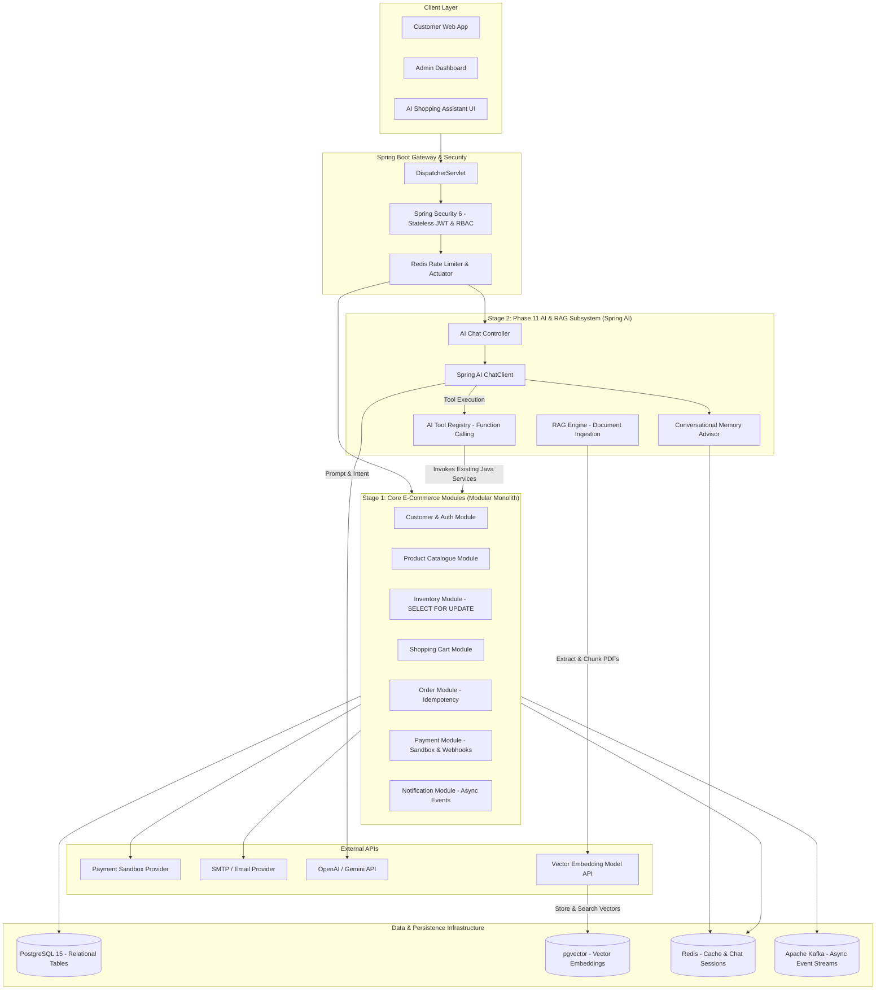
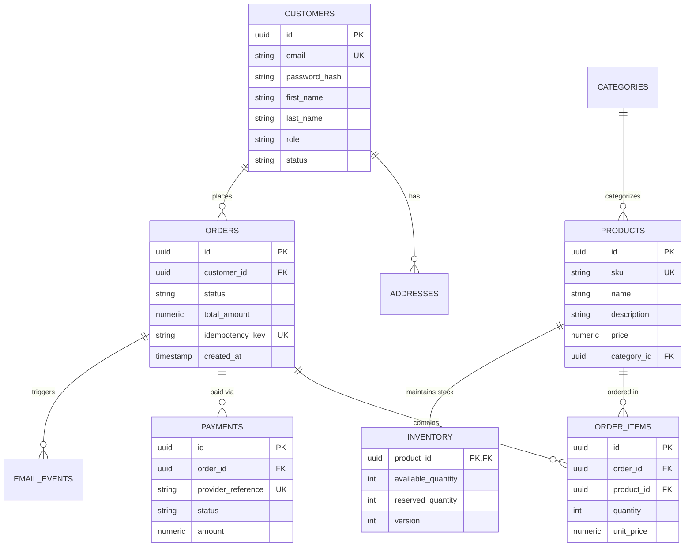
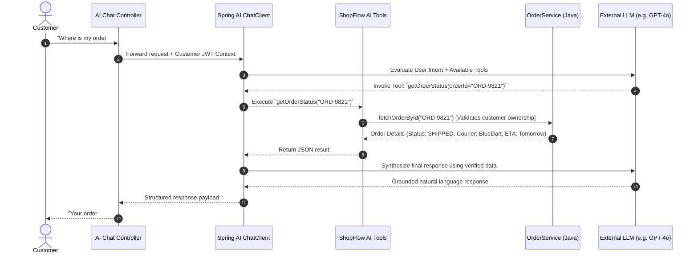

# ShopFlow AI — Intelligent E-Commerce Platform

[](https://openjdk.org/)
[](https://spring.io/projects/spring-boot)
[](https://spring.io/projects/spring-ai)
[](https://github.com/pgvector/pgvector)
[](https://www.docker.com/)
[](LICENSE)

> 📚 **Repository Documentation Index:**
> * **Primary Documentation (Current & Planned AI Extension):** `README.md` (You are here)
> * **Core Backend Blueprint (Phases 0 – 10 Pre-AI Foundation):** [`README_CORE_BACKEND.md`](README_CORE_BACKEND.md)

---

## 📑 Table of Contents
1. [Project Overview & Engineering Philosophy](#1-project-overview--engineering-philosophy)
2. [The Evolution Strategy: Two Clear Stages](#2-the-evolution-strategy-two-clear-stages)
   - [Stage 1 (Phases 0 – 10): Core ShopFlow Backend (Current Build)](#stage-1-phases-0--10-core-shopflow-backend-current-build)
   - [Stage 2 (Phase 11 Onwards): ShopFlow AI Extension (Planned Build)](#stage-2-phase-11-onwards-shopflow-ai-extension-planned-build)
   - [Will Adding AI Later Create Technical Problems? (Zero-Friction Architecture)](#will-adding-ai-later-create-technical-problems-zero-friction-architecture)
   - [The Core Implementation Rules](#the-core-implementation-rules)
3. [The Business Problem & User Scenarios](#3-the-business-problem--user-scenarios)
4. [High-Level System Architecture](#4-high-level-system-architecture)
5. [Part I: Core E-Commerce Backend (Phases 0 – 10)](#5-part-i-core-e-commerce-backend-phases-0--10)
   - [5.1 Target Personas](#51-target-personas)
   - [5.2 Module Breakdown & Functional Requirements](#52-module-breakdown--functional-requirements)
   - [5.3 Non-Functional Requirements (NFRs)](#53-non-functional-requirements-nfrs)
   - [5.4 Core Business Rules & Concurrency Edge Cases](#54-core-business-rules--concurrency-edge-cases)
   - [5.5 Modular Monolith Package Structure](#55-modular-monolith-package-structure)
   - [5.6 Relational Database Schema (ER Diagram)](#56-relational-database-schema-er-diagram)
   - [5.7 Phased Backend Roadmap (Phases 0 – 10)](#57-phased-backend-roadmap-phases-0--10)
6. [Part II: AI Engineering & Extension (Phase 11 Onwards)](#6-part-ii-ai-engineering--extension-phase-11-onwards)
   - [6.1 Why ShopFlow AI is Unique](#61-why-shopflow-ai-is-unique)
   - [6.2 The 5 Standout AI Features](#62-the-5-standout-ai-features)
   - [6.3 The 9-Step RAG Pipeline (pgvector)](#63-the-9-step-rag-pipeline-pgvector)
   - [6.4 AI Tool Calling (Connecting LLM to Java Services)](#64-ai-tool-calling-connecting-llm-to-java-services)
   - [6.5 Conversational Memory & Multi-Turn Context](#65-conversational-memory--multi-turn-context)
   - [6.6 AI Reliability, Groundedness & Evaluation](#66-ai-reliability-groundedness--evaluation)
   - [6.7 Existing Functionality vs. AI Enhancement Matrix](#67-existing-functionality-vs-ai-enhancement-matrix)
   - [6.8 Phase 11 Implementation Roadmap](#68-phase-11-implementation-roadmap)
7. [Technology Stack & Architectural Justifications](#7-technology-stack--architectural-justifications)
8. [Complete API Specification (REST & AI)](#8-complete-api-specification-rest--ai)
9. [Local Development & Docker Deployment](#9-local-development--docker-deployment)
10. [Resume & Portfolio Highlights (LaTeX Format)](#10-resume--portfolio-highlights-latex-format)

---

## 1. Project Overview & Engineering Philosophy

**ShopFlow AI — Intelligent E-Commerce Platform** is a production-grade, enterprise e-commerce platform built as a **Modular Monolith** in **Java 21** and **Spring Boot 3**, architected to seamlessly transition into an **Agentic AI & RAG Engine** using **Spring AI** and **PostgreSQL with pgvector**.

Instead of building another ordinary e-commerce clone or an isolated chatbot wrapper, ShopFlow AI combines **two major engineering dimensions**:
1. **Java Backend Engineering:** Spring Boot, REST APIs, stateless JWT security, relational databases, transactional boundaries, row-level concurrency locking (`SELECT ... FOR UPDATE`), caching, messaging, and automated integration testing with **Testcontainers**.
2. **AI Engineering:** Spring AI, LLM API integration, Retrieval-Augmented Generation (RAG), vector embeddings, PostgreSQL `pgvector`, autonomous AI tool calling, and session-isolated conversational memory.

---

## 2. The Evolution Strategy: Two Clear Stages

A critical design principle of this project is **progressive, disciplined engineering**. We do not mix AI experimentation with foundational business logic. The project evolves cleanly across two defined stages:

```
┌─────────────────────────────────────────────────────────────────────────────┐
│               STAGE 1: Core E-Commerce Backend (Phases 0 – 10)              │
│               [Currently Under Active Development - Pure Java Backend]       │
├─────────────────────────────────────────────────────────────────────────────┤
│  • User Registration & JWT Authentication                                   │
│  • Product Catalogue & Hierarchical Categories                             │
│  • Inventory Management & Concurrency-Safe Stock Reservation               │
│  • Shopping Cart & Order Lifecycle State Machine                           │
│  • Payment Simulation & Idempotent Webhook Processing                      │
│  • Automated Integration Testing with Testcontainers & PostgreSQL          │
└──────────────────────────────────────┬──────────────────────────────────────┘
                                       │
                                       ▼  Seamlessly Extends Into
┌─────────────────────────────────────────────────────────────────────────────┐
│             STAGE 2: ShopFlow AI Extension (Phase 11 Onwards)               │
│             [Next Development Frontier - Agentic AI & RAG Layer]            │
├─────────────────────────────────────────────────────────────────────────────┤
│  • Spring AI ChatClient & Structured Output Integration                     │
│  • RAG Pipeline for Product Manuals & Return Policies (pgvector)           │
│  • Deterministic AI Tool Calling (Orders, Inventory, Product Lookup)       │
│  • Conversational Memory & Isolated Multi-Turn Sessions                     │
│  • Hallucination Defense & Reliability Evaluation                          │
└─────────────────────────────────────────────────────────────────────────────┘
```

### Stage 1 (Phases 0 – 10): Core ShopFlow Backend (Current Build)
* **Status:** Built and hardened first.
* **Scope:** Complete e-commerce functionality using Java 21, Spring Boot, Spring Data JPA, PostgreSQL, Flyway, Spring Security, Docker, and Testcontainers.
* **Goal:** Establish a robust, bulletproof business application with strict transactional boundaries, proper DTO validation, and zero-defect data persistence before any AI components are introduced.

### Stage 2 (Phase 11 Onwards): ShopFlow AI Extension (Planned Build)
* **Status:** Commences immediately upon completion of Phase 10.
* **Scope:** Layering Spring AI, pgvector embeddings, and agentic workflows on top of the established backend.
* **Goal:** Transform the store into an autonomous, intent-driven shopping and customer support engine without breaking existing business logic.

---

### Will Adding AI Later Create Technical Problems? (Zero-Friction Architecture)

**No.** Because the system is architected as a clean modular monolith, adding AI later creates zero technical friction or breaking changes.

Consider how order tracking works before and after Phase 11:

```
[Core Backend Architecture (Current)]:
OrderController ──> OrderService ──> OrderRepository ──> PostgreSQL

[With Phase 11 AI Extension (Future)]:
AI Chat Controller ──> AI Assistant Service (Spring AI) ──> AI Tools ──> Existing OrderService ──> PostgreSQL
```

#### The Crucial Invariant:
> **The AI assistant reuses your existing `OrderService`.**  
> We do not duplicate order-management logic, and we **never** allow the LLM to directly query or manipulate database tables. The Java backend remains the **single source of truth**.

---

### The Core Implementation Rules
1. **Never modify the core roadmap just to introduce AI:** Complete the foundational ShopFlow functionality first (Phases 0 through 10).
2. **Keep the architecture modular:** Enforce clear boundaries so future AI integration is straightforward.
3. **Introduce Spring AI only once the core is stable:** Avoid dependency churn by adding AI starters to a working application.
4. **Follow a disciplined AI rollout:** Implement LLM connectivity first $\rightarrow$ then RAG and vector search $\rightarrow$ then tool calling $\rightarrow$ then evaluation.
5. **Test AI independently:** Test AI components in isolation and verify their interactions with existing business services.

---

## 3. The Business Problem & User Scenarios

### The Problem in Traditional E-Commerce
1. **The Discovery Gap:** Customers rarely search by exact product titles. They search with natural language requirements:
   > *"I need a laptop for programming under ₹60,000. Which one would you recommend?"*  
   Traditional SQL/keyword searches return empty or irrelevant results because they cannot evaluate technical trade-offs, budgets, or semantic intent.
2. **Disconnected Customer Support:** Customers need instant answers to operational and policy questions:
   > *"Can I return this laptop after 15 days if the seal is broken?"*  
   > *"Where is my order #ORD-9821?"*  
   Most sites route users through frustrating FAQ pages or generic, hallucination-prone chatbots that invent delivery dates and state incorrect policies.

### Concrete Scenarios in ShopFlow AI

#### Scenario 1: Intent-Driven Product Recommendation
* **Customer:** *"I need a laptop for programming under ₹60,000. Which one would you recommend?"*
* **ShopFlow AI Execution:**
  1. Understands the customer's programming requirements and budget ceiling (₹60,000).
  2. Executes backend tool to search the active product catalogue in PostgreSQL.
  3. Retrieves relevant product specifications (RAM, CPU, storage).
  4. Uses the LLM to evaluate trade-offs and generate tailored recommendations.
  5. Explains **why** each product is suitable for software development.
  6. Presents real product details, pricing, and live inventory directly from the database.

#### Scenario 2: Real-Time Order Support Assistant
* **Customer:** *"Where is my order?"*
* **ShopFlow AI Execution:**
  1. Identifies the user's intent and prompts for or extracts the order ID.
  2. Dispatches a backend tool call directly to `OrderService.fetchOrderStatus(orderId)`.
  3. Verifies customer identity and order ownership.
  4. Returns the verified status: *"Your order #ORD-9821 was shipped via BlueDart (Tracking: BLU-78219) and will arrive tomorrow."*
  5. **Guaranteed accuracy:** The AI never invents an order status.

#### Scenario 3: Document-Grounded Policy & Warranty Inquiries (RAG)
* **Customer:** *"Can I return this laptop after 15 days?"*
* **ShopFlow AI Execution:**
  1. Performs semantic vector retrieval across uploaded store policy PDFs in `pgvector`.
  2. Extracts the official return clause: *"Electronics may be returned within 14 days if opened; 30 days if unopened."*
  3. Generates a grounded response with direct policy citations, preventing misinformation.

---

## 4. High-Level System Architecture



---

# Part I: Core E-Commerce Backend (Phases 0 – 10)

---

## 5. Part I: Core E-Commerce Backend (Phases 0 – 10)

### 5.1 Target Personas
| Persona | Responsibilities & Needs | System Impact |
| :--- | :--- | :--- |
| **Customer** | Browses products, manages cart, places orders, views status, receives notifications. | Primary revenue path; requires sub-200ms latency and zero overselling. |
| **Administrator** | Manages catalog, updates inventory, reviews orders, uploads policy documents. | Operational control; secured via `ROLE_ADMIN` role-based access. |
| **External Systems**| Payment providers, email gateways, webhook consumers. | Integration boundaries requiring strict idempotency and retry mechanisms. |

### 5.2 Module Breakdown & Functional Requirements
1. **Customer Management:** Registration, login, profile management, password hashing via BCrypt, JWT generation.
2. **Product Catalogue:** Category hierarchies, SKU indexing, pricing, descriptions, images, pagination, and multi-field filtering.
3. **Inventory Management:** Stock tracking (`available_quantity` vs `reserved_quantity`), low-stock alerts, and concurrency safety.
4. **Order Management:** Multi-item checkout, price calculation, status lifecycle (`PENDING`, `PAID`, `SHIPPED`, `CANCELLED`), and ownership checks.
5. **Payment Integration:** Sandbox payment provider integration, asynchronous webhook handling, and idempotency protection.
6. **Notification Service:** Asynchronous order confirmation and payment receipt emails via Spring `@Async` with exponential back-off retries.
7. **Admin & Reporting:** Sales analytics, stock health reports, and administrative audit endpoints.

### 5.3 Non-Functional Requirements (NFRs)
* **Performance:** $\le 200\text{ ms}$ average response for read APIs; $\le 500\text{ ms}$ for writes under $100\text{ RPS}$.
* **Reliability:** $99.9\%$ uptime; graceful degradation if payment or notification services fail.
* **Security:** Stateless JWT authentication, BCrypt encryption ($12$ rounds), role-based access control, Jakarta validation.
* **Observability:** Structured JSON logs, Spring Boot Actuator endpoints (`/health`, `/metrics`), Prometheus export.
* **Testing:** High-reliability automated tests utilizing **Testcontainers** running real PostgreSQL instances.

### 5.4 Core Business Rules & Concurrency Edge Cases

```
                                [Place Order Request]
                                          │
                         Idempotency-Key validated?
                                   /             \
                             [YES]                [NO] ──> Return 409 Conflict / Cached Order
                                │
                 Lock Inventory (SELECT ... FOR UPDATE)
                                │
                     Sufficient stock in stock?
                                   /             \
                             [YES]                [NO] ──> Rollback & Return 400 Insufficient Stock
                                │
                 Reserve Stock & Create PENDING Order
                                │
                        Execute Payment Intent
                                   /             \
                         [SUCCESS]                [FAILURE] ──> Release Stock Reservation
                                │
                     Transition to PAID Order
```

| Edge Case | Description | Engineering Mitigation |
| :--- | :--- | :--- |
| **Concurrent Last-Item Purchase** | Multiple customers checkout the same last remaining SKU at the same millisecond. | Execute `SELECT ... FOR UPDATE` row-level pessimistic locking in PostgreSQL to serialize stock decrements. |
| **Duplicate Order Submission** | Customer double-clicks the "Place Order" button. | Client sends a unique `Idempotency-Key` (UUID). Repeat requests return cached order without re-billing. |
| **Payment Webhook Replay** | Payment provider retries webhooks on network lag. | Store `paymentProviderReference` with unique constraints; ignore already-processed events. |
| **Order Timeout** | Payment gateway responds slower than request timeout. | Order remains in `PENDING` status and is reconciled via webhook callback; no premature cancellation. |
| **Unauthorized Order Access** | Attacker tampers with order ID parameter in URL. | Service layer verifies authenticated customer ID against order owner; returns `403 Forbidden` on mismatch. |
| **Notification Failure** | Email service goes down during order placement. | Publish an asynchronous `EmailEvent` with exponential back-off retries; order transaction completes unimpeded. |
| **Partial Transaction Failure** | Inventory reservation succeeds but order creation fails. | Enclose entire checkout in a single `@Transactional` boundary; ensure complete automatic rollback. |

### 5.5 Modular Monolith Package Structure
```
com.shopflow/
├── ShopFlowApplication.java
├── common/                  # ApiResponse<T>, GlobalExceptionHandler, Constants
├── config/                  # SecurityConfig, FlywayConfig, ActuatorConfig, RedisConfig
├── customer/                # Customer entity, Repository, Service, Controller
├── product/                 # Product, Category, Repository, Service, Controller
├── inventory/               # Inventory entity, InventoryLockService, Repository
├── order/                   # Order, OrderItem, OrderStateMachine, Service, Controller
├── payment/                 # PaymentTransaction, WebhookController, Service
├── notification/            # EmailEvent, NotificationService, RetryScheduler
├── admin/                   # AdminDashboardController, ReportingService
└── ai/                      # Phase 11 AI modules (ChatClient, Tools, RAG, Memory)
```

### 5.6 Relational Database Schema (ER Diagram)


### 5.7 Phased Backend Roadmap (Phases 0 – 10)
* **Phase 0 – Blueprint:** Domain modeling, package contracts, OpenAPI specifications.
* **Phase 1 – Foundation:** Spring Boot scaffold, PostgreSQL connectivity, Flyway migrations, health checks.
* **Phase 2 – Product Catalogue:** Dynamic catalog CRUD, categories, pagination, validation.
* **Phase 3 – Customer Management:** Customer profiles, addresses, BCrypt hashing.
* **Phase 4 – Auth & Security:** Stateless JWT authentication, role guards (`ROLE_CUSTOMER`, `ROLE_ADMIN`).
* **Phase 5 – Inventory Management:** Concurrency control, `SELECT ... FOR UPDATE`, race condition testing.
* **Phase 6 – Order Lifecycle:** Idempotent checkout, order state machine, stock reservation rollbacks.
* **Phase 7 – Payment Integration:** Mock payment gateway, asynchronous webhook processing, replay defense.
* **Phase 8 – Notifications:** Async email event dispatching, dead-letter logging, exponential backoff retries.
* **Phase 9 – Quality & Test Automation:** Integration test suite with Testcontainers, Mockito, JUnit 5 ($\ge 80\%$ coverage).
* **Phase 10 – Production DevOps:** Multi-stage Docker builds, Docker Compose orchestration, Actuator metrics.

---

# Part II: AI Engineering & Extension (Phase 11 Onwards)

---

## 6. Part II: AI Engineering & Extension (Phase 11 Onwards)

Once the core e-commerce backend is verified and stable, **Phase 11** introduces the AI subsystem.

### 6.1 Why ShopFlow AI is Unique
1. **Real Business Operations Over Generic Chat:** The AI assistant does not operate in a vacuum. It directly accesses inventory, checks product availability, and looks up orders.
2. **Strict Non-Hallucination Invariant:** The AI model is strictly prohibited from inventing order statuses, guessing inventory levels, or fabricating return terms.
3. **Unified Vector & Relational Storage:** Utilizes **PostgreSQL + pgvector** rather than separate, expensive vector database services.

---

### 6.2 The 5 Standout AI Features

#### 1. AI Shopping Assistant
* Understands natural language requests and recommends products using real catalog information.
* *Concepts:* LLM API, Prompt Engineering, Spring AI `ChatClient`, Structured JSON Output.

#### 2. RAG-Based Product & Policy Assistant
* Upload product manuals, FAQs, warranty documents, and return policies. Customers ask questions directly against these verified documents.
* *Concepts:* Document ingestion, chunking, embeddings, vector database, similarity search, RAG.

#### 3. AI Tool Calling (Function Calling)
* Assistant autonomously invokes Java backend functions to retrieve order statuses, check product availability, and fetch order details.
* *Concepts:* Function calling, Spring AI `@Tool`, service integration, authorization context propagation.

#### 4. Conversational Memory
* Remembers customer context and preferences across multi-turn dialogues with strict customer session isolation.
* *Concepts:* Chat memory, conversation IDs, persistent storage, session isolation.

#### 5. AI Reliability & Evaluation
* Measures retrieval confidence, checks citations, handles unsupported questions gracefully, and records AI failures.
* *Concepts:* Groundedness verification, hallucination defense, evaluation, observability, fallback handling.

---

### 6.3 The 9-Step RAG Pipeline (pgvector)

```
[ADMIN PDF UPLOAD]
       │
       ▼
[Step 1: Document Ingestion]  Admin uploads warranty/policy PDF (e.g. Return_Policy_2026.pdf).
       │
       ▼
[Step 2: Text Extraction]     Spring AI DocumentReader / Apache Tika extracts raw text and metadata.
       │
       ▼
[Step 3: Chunking]            TokenTextSplitter divides document into 500-token chunks with 50-token overlap.
       │
       ▼
[Step 4: Embeddings]          EmbeddingModel (e.g., text-embedding-3-small) generates vector representations.
       │
       ▼
[Step 5: Vector Storage]      Vectors, chunk text, and metadata are saved in PostgreSQL pgvector table.
       │
       ├──────────────────────────────────────────────────────────────────┐
       ▼                                                                  ▼
[CUSTOMER INTERACTION]                                            [DATABASE STATE]
       │                                                                  │
[Step 6: User Question]       Customer asks: "Can I return this laptop after 15 days?"
       │                                                                  │
[Step 7: Semantic Retrieval]  Query vector generated; Cosine similarity search executes against pgvector.
       │                      `SELECT content FROM vector_store ORDER BY embedding <=> query_vector LIMIT 3;`
       ▼                                                                  │
[Step 8: LLM Integration]     Spring AI sends retrieved policy context + original customer question to LLM.
       │
       ▼
[Step 9: Grounded Response]   LLM produces an answer strictly derived from context with explicit policy citations.
```

---

### 6.4 AI Tool Calling (Connecting LLM to Java Services)

The assistant uses **Spring AI Function Calling** to query existing Java business services:



#### Example Java Tool Implementation:
```java
@Configuration
public class ShopFlowAIToolsConfig {

    @Bean
    @Description("Check real-time stock availability for a given product SKU")
    public Function<StockCheckRequest, StockCheckResponse> checkInventory(InventoryService inventoryService) {
        return request -> {
            int available = inventoryService.getAvailableQuantity(request.sku());
            return new StockCheckResponse(request.sku(), available, available > 0);
        };
    }

    @Bean
    @Description("Fetch live order tracking and shipping status for authenticated customer")
    public Function<OrderStatusRequest, OrderStatusResponse> getOrderStatus(OrderService orderService) {
        return request -> {
            Order order = orderService.getCustomerOrder(request.orderId());
            return new OrderStatusResponse(order.getId(), order.getStatus().name(), order.getTrackingNumber());
        };
    }
}
```

---

### 6.5 Conversational Memory & Multi-Turn Context
* Every customer session is tracked by a unique `conversationId` tied to their authenticated `userId`.
* Spring AI's `PromptChatMemoryAdvisor` maintains conversational context windows in Redis.
* Session isolation prevents any cross-customer memory leaks.

---

### 6.6 AI Reliability, Groundedness & Evaluation
* **Confidence Guardrails:** If the top vector similarity match is below $0.75$, the assistant defaults to:
  > *"I cannot find that in our official store policies. Please contact customer support at support@shopflow.com."*
* **Low Temperature:** Uses temperature $0.1 - 0.2$ for operational tools to eliminate creative hallucinations.
* **Audit Logging:** Unrecognized queries and tool execution errors are logged for evaluation and continuous tuning.

---

### 6.7 Existing Functionality vs. AI Enhancement Matrix

| Existing Functionality (Phases 0–10) | Phase 11 AI Enhancement |
| :--- | :--- |
| **Product Catalogue** | **AI Product Recommendations:** Understands needs and generates comparative suggestions. |
| **Product Search** | **Natural-Language Product Search:** Replaces keyword search with intent-driven semantic search. |
| **Product Documentation** | **RAG-Based Product Assistant:** Answers technical questions from uploaded PDF manuals. |
| **Return Policies** | **RAG-Based Policy Assistant:** Clarifies returns and warranties directly from policy documents. |
| **Order Management** | **AI Order-Tracking Assistant:** Performs autonomous lookups using backend tools to fetch real-time state. |
| **Customer Support** | **AI Support Assistant:** Resolves first-tier customer inquiries 24/7 without manual ticketing. |
| **Customer Conversations** | **Conversational Memory:** Preserves multi-turn shopping context across the session. |

---

### 6.8 Phase 11 Implementation Roadmap
```
Phase 11: AI Extension & Intelligence Layer
├── 11.1: Dependency Setup (Spring AI BOM, OpenAI / Gemini starters)
├── 11.2: PostgreSQL pgvector Extension & Migration Scripts (V2__init_pgvector.sql)
├── 11.3: Document Ingestion Pipeline (PDF Parser, Token Splitter, Vectorizer)
├── 11.4: RAG Implementation for Policies & Product Manuals
├── 11.5: Spring AI Tool Calling Configuration (Inventory, Catalog, Order Services)
├── 11.6: Conversational Memory & Redis Chat Session Store
├── 11.7: Hallucination Guardrails, Fallbacks & Evaluation Framework
└── 11.8: AI Chat Controller & REST Endpoint Documentation
```

---

## 7. Technology Stack & Architectural Justifications

| Layer | Technologies | Architectural Justification |
| :--- | :--- | :--- |
| **Programming Language** | Java 21 (LTS) | Modern language ergonomics (Records, Pattern Matching, Virtual Threads). |
| **Backend Framework** | Spring Boot 3.2+ | Industry-standard dependency injection, enterprise security, and actuator metrics. |
| **AI Framework** | Spring AI 1.0.0+ | Native Java POJO abstractions for LLMs, prompt management, and vector stores. |
| **Relational Database**| PostgreSQL 15 | Strict ACID transactions, row-level concurrency locks, and proven reliability. |
| **Vector Engine** | PostgreSQL `pgvector` | Eliminates separate vector DB infrastructure by storing embeddings in PostgreSQL. |
| **Caching & Memory** | Redis 7 | High-speed distributed caching, session tokens, and chat history storage. |
| **Messaging** | Apache Kafka | Asynchronous event streaming for decoupled order processing and notifications. |
| **Database Migrations**| Flyway | Deterministic, version-controlled schema evolution with zero drift. |
| **Testing** | JUnit 5 + Mockito + Testcontainers | Real database testing inside ephemeral Docker containers; eliminates mock drift. |
| **Containerization** | Docker & Docker Compose | Multi-stage build producing slim JRE runtime images with automated health checks. |

> **Spring AI Version Compatibility Note:** Spring AI releases maintain strict compatibility alignments with Spring Boot versions. For Spring Boot 3.2.x – 3.3.x, use **Spring AI 1.0.0-M6** or **1.0.0 Milestone releases**. Verify compatibility before upgrading.

---

## 8. Complete API Specification (REST & AI)

### Core Business APIs
```http
POST   /api/v1/auth/register            # Register new customer
POST   /api/v1/auth/login               # Authenticate & retrieve JWT
GET    /api/v1/products                 # Paginated catalog search & filter
GET    /api/v1/products/{id}            # Get product details by UUID
POST   /api/v1/cart/items               # Add item to shopping cart
POST   /api/v1/orders                   # Create order (Idempotency-Key header)
GET    /api/v1/orders/{id}              # Get order status & tracking info
POST   /api/v1/payments/webhook         # Process payment provider webhook
```

### Phase 11 AI & RAG APIs
```http
POST   /api/v1/ai/chat                  # Interactive chat with AI Shopping Assistant
POST   /api/v1/ai/rag/query             # Query product policies & warranty documents
POST   /api/v1/ai/rag/ingest            # Admin endpoint: Upload PDF for vectorization
DELETE /api/v1/ai/chat/history          # Clear active conversational memory
```

#### Sample AI Chat Request:
```json
POST /api/v1/ai/chat
Authorization: Bearer <jwt-token>
Content-Type: application/json

{
  "conversationId": "session-908124",
  "message": "Where is my order #ORD-9821?"
}
```

#### Sample AI Chat Response:
```json
{
  "success": true,
  "data": {
    "conversationId": "session-908124",
    "reply": "Your order #ORD-9821 is currently SHIPPED. It was dispatched via BlueDart (Tracking ID: BLU-78219) and is scheduled to arrive tomorrow.",
    "toolsExecuted": ["getOrderStatus"],
    "citations": []
  }
}
```

---

## 9. Local Development & Docker Deployment

### Prerequisites
* **Java 21 SDK** (Eclipse Temurin or OpenJDK)
* **Maven 3.9+** (or use bundled `./mvnw`)
* **Docker & Docker Compose**
* **OpenAI or Gemini API Key**

### 1. Clone & Configure Environment
```bash
git clone https://github.com/harisai-singuluri/ShopFlow----AI-Powered-E-Commerce-Platform.git
cd ShopFlow----AI-Powered-E-Commerce-Platform
```

Create a `.env` file in the project root:
```bash
# Application Configuration
SPRING_PROFILES_ACTIVE=local
SERVER_PORT=8080

# Database Configuration (PostgreSQL + pgvector)
SPRING_DATASOURCE_URL=jdbc:postgresql://localhost:5433/shopflow
POSTGRES_USER=shopflow_user
POSTGRES_PASSWORD=shopflow_pass

# AI Configuration (Phase 11)
SPRING_AI_OPENAI_API_KEY=your_openai_api_key_here
SPRING_AI_OPENAI_CHAT_MODEL=gpt-4o-mini
SPRING_AI_OPENAI_EMBEDDING_MODEL=text-embedding-3-small
```

### 2. Launch Database with pgvector via Docker Compose
```bash
docker compose up -d db
```

### 3. Build and Run the Application
```bash
./mvnw clean spring-boot:run
```

Access the interactive API documentation at:
* **Swagger OpenAPI:** `http://localhost:8080/swagger-ui.html`
* **Health Endpoint:** `http://localhost:8080/actuator/health`

### 4. Run Automated Test Suite
```bash
# Runs Unit Tests and Testcontainers Integration Tests
./mvnw clean test
```

---

## 10. Resume & Portfolio Highlights (LaTeX Format)

When presenting **ShopFlow AI** to recruiters and engineering hiring managers on your resume:

```latex
\textbf{ShopFlow AI -- Intelligent E-Commerce Platform}
\hfill 
\href{https://github.com/harisai-singuluri/ShopFlow----AI-Powered-E-Commerce-Platform}{\textcolor{blue}{Link}}
\begin{itemize}
    \item Developed an enterprise e-commerce platform using Java 21 and Spring Boot 3, implementing concurrency-safe stock reservation, idempotent order lifecycles, and role-based access control.
    \item Built an intelligent RAG discovery engine with Spring AI and pgvector, enabling natural language product recommendations and automated semantic search across product documentation.
    \item Implemented deterministic AI Tool Calling to securely query backend services for real-time order tracking and inventory checks, containerizing deployments via multi-stage Docker.
\end{itemize}
```

---

*Authored and architected with high engineering standards — ShopFlow AI Engineering Team.*
