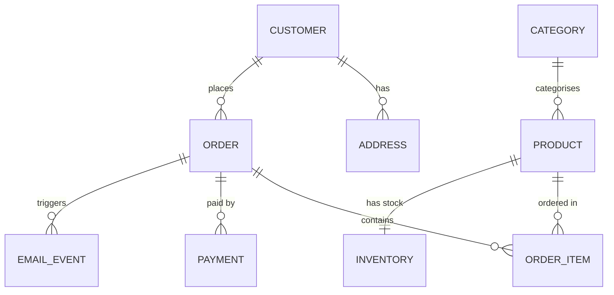

# ShopFlow – Production‑Grade E‑Commerce & Order Management Backend

> **Note:** This document contains the foundational **Core Backend Blueprint (Phases 0 – 10)** for ShopFlow before the Phase 11 AI extension.  
> For the complete, updated project documentation featuring the **AI Integration & Intelligence Layer**, please refer to the primary [README.md](README.md).

---

## 1. Project Title & High‑Level Objective
**Project Title:** **ShopFlow**

**Goal:** Build a realistic, production‑grade backend for an e‑commerce platform that can be used as a learning vehicle for a junior engineer to acquire the full set of skills required of a Java backend professional.  The code will be organized as a **modular monolith** so that we can focus on domain modelling, transactions, security, testing and deployment without the operational overhead of micro‑services.

---

## 2. Target Users & Personas
| Persona | What they need | Why it matters |
|---------|----------------|----------------|
| **Customer** (anonymous or logged‑in) | Browse products, manage a shopping cart, place orders, view order status, receive email notifications. | Core revenue‑generating flow. |
| **Administrator** (staff role) | Manage product catalogue, inventory, customers, orders; run reports; change system configuration. | Operational control and business insights. |
| **External Services** | Payment provider, email service, optional webhook consumers. | Integration points that must be robust and idempotent. |

---

## 3. Functional Requirements (What the system must do)
### Module‑wise breakdown
1. **Customer Management**
   - Register, login, reset password.
   - CRUD profile and address data.
   - Account activation / deactivation.
2. **Product Catalogue**
   - Create / update / delete products and categories.
   - SKU handling, pricing, description, images (metadata only).
   - Search, filter, sort, paginate.
3. **Inventory Management**
   - Track `available_quantity` per SKU.
   - Reserve stock when an order is created, release on cancel/timeout.
   - Prevent overselling via row‑level locking/optimistic locking.
4. **Order Management**
   - Create an order containing multiple line items.
   - Validate product availability and compute totals.
   - Store order status (`PENDING`, `PAID`, `SHIPPED`, `CANCELLED`).
   - Enforce ownership – a customer can only view/modify *their* orders.
5. **Payment Integration**
   - Initiate a payment request to a sandbox provider.
   - Process asynchronous webhook callbacks.
   - Ensure idempotency so duplicate webhooks do not create duplicate payments.
6. **Notifications**
   - Send order‑confirmation and payment‑status emails.
   - Retry on temporary email‑service failure.
7. **Admin & Reporting**
   - CRUD admin UI endpoints (secured by role). 
   - Sales report, low‑stock report, order‑history export.

---

## 4. Non‑Functional Requirements (NFRs)
| Category | Requirement | Rationale |
|----------|--------------|-----------|
| **Performance** | ≤ 200 ms average response for read‑only APIs; ≤ 500 ms for write APIs under 100 RPS. | End‑user experience. |
| **Reliability** | 99.9 % uptime; graceful degradation when external email/payments are down. | Business continuity. |
| **Scalability** | Horizontal scaling via Docker containers; database connection pooling. | Future growth. |
| **Security** | JWT stateless authentication; password hashing with BCrypt; role‑based access control; input validation; rate limiting on login. | Protect user data & prevent abuse. |
| **Maintainability** | Clear package/module separation; comprehensive unit + integration tests; CI pipeline. | Team productivity. |
| **Observability** | Structured logs (JSON), health‑check endpoint, basic metrics (Prometheus‑compatible). | Debugging & ops. |
| **Portability** | Run locally with Docker‑compose; deploy to any Linux host. | Development convenience. |

---

## 5. Core Business Rules & Edge Cases (What can go wrong)
| Rule / Edge case | Description | Engineering treatment |
|-------------------|-------------|----------------------|
| **Concurrent purchase of last item** | Two customers request the same SKU when only one unit remains. | Use a DB transaction with `SELECT … FOR UPDATE` or optimistic locking (`@Version`) to serialize stock decrement. |
| **Duplicate order submission** | Customer double‑clicks “Place Order”. | Generate an **idempotency key** (client‑generated UUID) and store it with the order; reject repeats. |
| **Payment webhook replay** | Provider may resend the same webhook if it did not receive ACK. | Store a unique `paymentProviderReference`; ignore already‑processed events. |
| **Order timeout** | Payment provider confirms later than the request‑timeout. | Persist order with `PENDING` status and reconcile via webhook; do not cancel automatically. |
| **Unauthorized order access** | Customer changes the order ID in the URL. | Enforce ownership check in service layer; return **403 Forbidden** if mismatch. |
| **External email service outage** | Notification fails after order is placed. | Asynchronously publish an `EmailEvent`; use retry with exponential back‑off; log failures for manual re‑try. |
| **Partial transaction failure** | Inventory reservation succeeds but payment fails. | Entire order creation is wrapped in a single DB transaction; on payment failure, roll back reservation. |

---

## 6. Architecture Overview
### 6.1 What is a **Modular Monolith**?
- **Monolith**: a single deployable artifact (one Spring Boot jar) that contains the whole codebase.
- **Modular**: the code is split into logical **Java modules / packages** (e.g., `customer`, `product`, `order`) that have **clean boundaries** (only expose interfaces, no circular dependencies).\
- **Why now?**
  - Allows us to practise *domain‑driven design* and *transaction boundaries* without the operational overhead of multiple services (service discovery, networking, deployment pipelines).
  - When the need for separate services arises, we can extract a module into its own micro‑service with minimal refactor (the “modular monolith to micro‑service” path).

### 6.2 High‑level Component Diagram
```mermaid
flowchart TD
    subgraph Client
        C[Frontend / Postman]
    end
    subgraph API_Gateway[Spring Boot (ShopFlow)]
        D[DispatcherServlet]
        subgraph Controllers
            C1[CustomerController]
            C2[ProductController]
            C3[OrderController]
            C4[AdminController]
        end
        subgraph Services
            S1[CustomerService]
            S2[ProductService]
            S3[OrderService]
            S4[PaymentService]
            S5[NotificationService]
        end
        subgraph Repositories
            R1[CustomerRepository]
            R2[ProductRepository]
            R3[OrderRepository]
            R4[PaymentRepository]
        end
    end
    subgraph DB[PostgreSQL]
        DB1[(shopflow)]
    end
    subgraph External[External Services]
        P[Payment Provider]
        E[Email Service]
    end
    C -->|HTTP| D
    D --> Controllers
    Controllers --> Services
    Services --> Repositories
    Repositories --> DB1
    Services -->|REST| P
    Services -->|SMTP/REST| E
```
*The flow shows a request entering Spring, being routed to a controller, passing through a service layer, persisting via a repository, and optionally calling an external system.*

---

## 7. Modules & Package Layout (Physical Structure)
```
shopflow/
│   pom.xml                     # Maven parent
└─ src/main/java/com/shopflow
   ├─ common                     # utilities, constants, error handling
   ├─ config                     # Spring configuration, security, beans
   ├─ customer
   │   ├─ controller
   │   ├─ service
   │   ├─ repository
   │   └─ model   (entity, dto)
   ├─ product
   │   ├─ controller
   │   ├─ service
   │   ├─ repository
   │   └─ model
   ├─ inventory
   │   ├─ service
   │   └─ model
   ├─ order
   │   ├─ controller
   │   ├─ service
   │   ├─ repository
   │   └─ model
   ├─ payment
   │   ├─ controller   (webhook)
   │   ├─ service
   │   └─ model
   ├─ notification
   │   ├─ service
   │   └─ model
   └─ admin
       ├─ controller
       ├─ service
       └─ model
```
*Each module owns its own domain objects, repository interfaces and service contracts.  Cross‑module calls go **only through service interfaces** – this keeps boundaries clear.*

---

## 8. Database Design (ER Diagram)
### 8.1 Core Tables (simplified)
| Table | Primary Key | Important Columns | Relationships |
|-------|------------|-------------------|---------------|
| `customers` | `id` (UUID) | `email`, `password_hash`, `first_name`, `last_name`, `status` | 1‑M `addresses` |
| `addresses` | `id` | `street`, `city`, `state`, `zip` | M‑1 `customer_id` |
| `products` | `id` | `sku`, `name`, `description`, `price`, `category_id` | M‑1 `category_id` |
| `categories` | `id` | `name`, `parent_id` | self‑reference for hierarchy |
| `inventory` | `product_id` (PK, FK) | `available_quantity`, `reserved_quantity` | 1‑1 `products` |
| `orders` | `id` | `customer_id`, `status`, `total_amount`, `created_at` | M‑1 `customer_id` |
| `order_items` | `id` | `order_id`, `product_id`, `quantity`, `unit_price` | M‑1 `order_id`, M‑1 `product_id` |
| `payments` | `id` | `order_id`, `provider_reference`, `status`, `amount` | M‑1 `order_id` |
| `email_events` | `id` | `order_id`, `type`, `status`, `attempts` | M‑1 `order_id` |

### 8.2 Mermaid ER Diagram (textual version)

*The diagram visualises foreign‑key relationships; every `FK` is declared with `ON DELETE RESTRICT` to avoid cascading data loss.*

---

## 9. API Design Principles
1. **Versioned URL** – `/api/v1/...` to allow future breaking changes.
2. **RESTful resources** – nouns (`/customers`, `/products/{id}`) with appropriate HTTP verbs.
3. **Standard response envelope** – `{ "data": …, "error": null }` for successful calls; `{ "data": null, "error": { "code": "..., "message": "..." } }` for failures.
4. **Pagination** – `page`, `size`, `sort` query params; `Link` header for next/prev.
5. **Filtering & Sorting** – query params like `name=Phone&minPrice=100&maxPrice=500&sort=price,desc`.
6. **Error handling** – map exceptions to HTTP status codes (e.g., `EntityNotFoundException → 404`).
7. **Idempotency** – write‑only endpoints accept optional header `Idempotency-Key`.
8. **Authentication** – `Authorization: Bearer <jwt>` header; JWT contains `sub` (customer id) and `roles`.
9. **OpenAPI (Swagger)** – generated automatically from controller annotations for documentation.

---

## 10. Technical Stack (Why each piece is chosen)
| Layer | Technology | Reason |
|-------|-------------|--------|
| **Language** | Java 21 (LTS) | Modern language features, long‑term support.
| **Framework** | Spring Boot 3.x + Spring MVC | Convention‑over‑configuration, extensive ecosystem.
| **Persistence** | Spring Data JPA + Hibernate | Declarative repository API, automatic SQL generation, transaction management.
| **Database** | PostgreSQL 15 | Strong ACID guarantees, rich SQL, good tooling.
| **Security** | Spring Security + JWT | Stateless authentication, easy role‑based ACL.
| **Build** | Maven 3.9 | Widely used, deterministic builds.
| **Testing** | JUnit 5, Mockito, Spring Boot Test, MockMvc, Testcontainers (Postgres) | Unit, integration and containerized DB tests.
| **Containerisation** | Docker + Docker‑Compose | Consistent dev environment, CI pipeline.
| **CI/CD** | GitHub Actions (or any CI) | Automated build, test, Docker image.
| **Logging** | Logback (JSON layout) | Structured logs for observability.
| **Metrics** | Micrometer + Prometheus exporter | Basic health & performance metrics.
| **Documentation** | Springdoc OpenAPI UI | Interactive API docs.

---

## 11. Project Structure & Repository Conventions
- **Branching model** – `main` (stable), `develop` (integration), feature branches `feature/<ticket-id>-<short-name>`.
- **Commit style** – Conventional Commits (`feat: add product API`, `fix: correct NPE in OrderService`).
- **Pull‑request template** – includes checklist for tests, documentation, linting.
- **Code style** – Google Java Style Guide (or Spotless with `google-java-format`).
- **Static analysis** – SpotBugs, PMD, Checkstyle as part of CI.
- **Documentation folder** – `docs/` containing architecture diagram, ER diagram, API spec, ADRs (Architecture Decision Records).
- **Scripts** – `scripts/` for Docker‑Compose, DB migration (`flyway`), CI helpers.

---

## 12. Development Roadmap (Phase‑by‑Phase)
| Phase | Goal | Deliverable |
|-------|------|-------------|
| **0 – Blueprint** | Full specifications, diagrams, repo init. | `README.md`, `docs/` (architecture, ER, API spec), empty Maven project. |
| **1 – Foundation** | Scaffold Spring Boot, DB config, CI pipeline, basic health endpoint. | Runnable jar, Docker‑Compose (Postgres + app), GitHub repo with initial commit. |
| **2 – Product Catalogue** | CRUD for products, category hierarchy, validation, pagination. | Controllers, services, repositories, unit & integration tests, OpenAPI docs. |
| **3 – Customer Management** | Registration, profile, address CRUD, password hashing. | Secure password storage, email verification stub, tests. |
| **4 – Auth & Authorization** | JWT login, role‑based guards, global exception handling. | `/auth/login`, filter chain, `ROLE_CUSTOMER`, `ROLE_ADMIN`. |
| **5 – Inventory Management** | Stock entity, reservation logic, optimistic locking, low‑stock alert. | Transactional service, tests for race condition simulation. |
| **6 – Order Management** | End‑to‑end order flow, idempotency, ownership checks, status lifecycle. | Full order API, order‑item handling, transaction boundaries, tests. |
| **7 – Payment Integration** | Sandbox payment client, webhook endpoint, idempotent processing. | Payment service, retry logic, testcontainers mock server. |
| **8 – Notifications** | Async email via Spring `@Async` (or simple executor), retry with back‑off, audit table. | Email service, scheduled retry job, tests. |
| **9 – Advanced Testing & Quality** | Testcoverage ≥ 80 %, mutation testing, CI pipeline enforcement. | GitHub Actions workflow, Testcontainers integration, code coverage badge. |
| **10 – Production Engineering** | Docker image, Helm chart (optional), CI‑CD deploy to a cloud VM, monitoring, health checks. | Dockerfile, `docker-compose.yml`, CI workflow that builds & pushes image, README deployment steps. |

*Each phase follows the learning loop:* **Requirement → Concept → Design → Implementation → Test → Debug → Review → Independent exercise**.

---

## 13. Common Beginner Mistakes & Professional Mitigations
| Mistake | Why it happens | How a senior engineer avoids it |
|---------|----------------|--------------------------------|
| **Putting business logic in controllers** | Controllers are the first thing you learn; logic feels “easy” there. | Keep controllers thin – they only translate HTTP → DTO and delegate to a service layer. |
| **Hard‑coding DB credentials** | Quick local testing. | Externalise configuration (`application‑{profile}.yaml`), use environment variables, never commit secrets. |
| **Ignoring transaction boundaries** | Assumes each repository call is independent. | Annotate service methods with `@Transactional`; understand propagation rules. |
| **Using `LazyInitializationException`** | Accessing a JPA entity outside a transaction. | Fetch required associations eagerly for the use‑case, or use DTO projections. |
| **Swallowing exceptions** | “Just printStackTrace()”. | Centralised `@ControllerAdvice` to map exceptions to HTTP responses, log with correlation IDs. |
| **Missing validation** | Rely on client to send correct data. | Use Bean Validation (`@Valid`, `@NotBlank`) and fail fast. |
| **No tests** | “It works locally”. | Write a failing test first (TDD) or at least a smoke test; CI will block merges if tests fail. |
| **Over‑engineering (micro‑services too early)** | Excitement about cutting‑edge tech. | Start with a modular monolith; only extract services when clear scaling or team‑ownership needs appear. |
| **Spaghetti commit history** | Many unrelated changes in one PR. | Follow small, focused PRs; each PR addresses one user story or bug. |

---

## 14. Quick Start
```bash
# Clone
git clone https://github.com/harisai-singuluri/ShopFlow----AI-Powered-E-Commerce-Platform.git
cd ShopFlow----AI-Powered-E-Commerce-Platform

# Start dependencies
docker compose up -d

# Build & run
./mvnw spring-boot:run
```

---

## 15. Next Steps
1. **Read through this blueprint** – review domain entities, transaction boundaries, and design.
2. **Phase 1 to Phase 10 execution:** Complete core e-commerce modular monolith with zero AI dependency.
3. **Phase 11:** Transition to [README.md](README.md) for the AI Extension and RAG integration.

---

*Prepared by your senior Java backend mentor – Antigravity*
